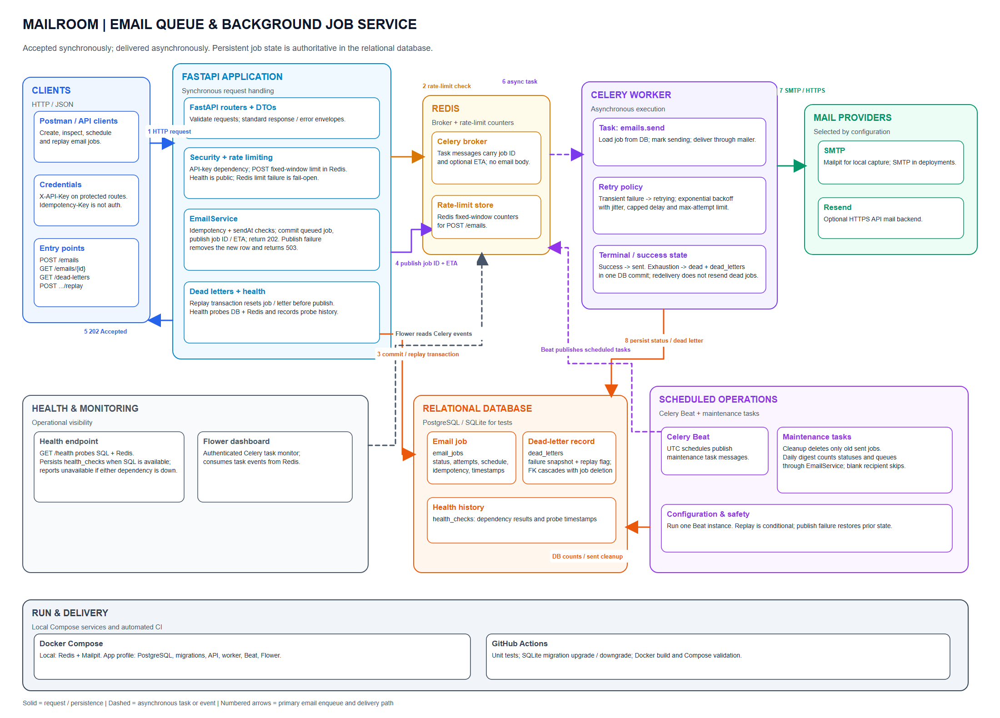

# Mailroom — Email Queue and Background Job Service

Mailroom is a FastAPI service that accepts email requests, stores job state in a
relational database, and dispatches delivery to Celery workers through Redis.
Callers receive an acceptance response without waiting for the email provider.
Jobs can be scheduled, retried with backoff, inspected, and replayed from the
dead-letter API.

## Technology stack

- Python 3.12, FastAPI, Pydantic
- SQLAlchemy and Alembic
- PostgreSQL (SQLite is also supported for local tests)
- Celery and Redis for background tasks and scheduling
- SMTP (Mailpit locally) or the Resend HTTPS API for outbound email
- Flower for authenticated Celery monitoring
- Docker Compose and GitHub Actions

## Architecture



The diagram is fully editable in Excalidraw:
[system-architecture.excalidraw](.github/docs/architecture/system-architecture.excalidraw).
Vector export: [system-architecture.svg](.github/docs/architecture/system-architecture.svg).

## End-to-end execution flows

### 1. Queue and send an email

1. A client submits `POST /emails` with a valid `X-API-Key`. The public
   `GET /health` endpoint is the exception and does not require a key.
2. FastAPI validates the request. For `POST /emails`, the API checks a
   per-client fixed-window rate limit in Redis. Excess requests return `429`
   with `Retry-After`.
3. `EmailService` checks the optional idempotency key and scheduled send time,
   then `EmailQuery` commits the `queued` job to `email_jobs`.
4. The API publishes only the job ID (and optional ETA) to the Celery queue in
   Redis, records the task ID, and returns `202`. If publishing fails, it
   removes the just-created row and returns `503`.
5. A Celery worker consumes `emails.send`, marks the job `sending`, and sends
   through the configured SMTP or Resend backend. The worker persists the
   resulting `sent` status or retry state in PostgreSQL.
6. On delivery failure, Celery retries with exponential backoff and jitter.
   When the attempt limit is reached, one database commit marks the job `dead`
   and adds its snapshot to `dead_letters`.

Delivery is at-least-once: a process crash after a mail provider accepts a
message but before the success status is committed may cause a duplicate send.

### 2. Inspect and replay a dead letter

Use the authenticated `GET /dead-letters` and `GET /dead-letters/{id}` endpoints
to inspect failures. `POST /dead-letters/{id}/replay` conditionally marks the
letter replayed and resets its job to `queued` in one database transaction. It
then publishes the job ID to Redis. A second replay returns `409`; if publishing
fails, the API restores the job and letter state and returns `503`.

### 3. Health check

`GET /health` checks PostgreSQL and Redis, stores a health-check record when
PostgreSQL is available, and reports service unavailable if either dependency
is unhealthy.

### 4. Scheduled maintenance

Celery Beat publishes two UTC schedules to Redis. The cleanup task deletes only
old `sent` jobs. The daily digest task queries status counts and queues a normal
email through `EmailService` with a per-UTC-day idempotency key. A blank
`DIGEST_TO_EMAIL` disables the digest.

## Component responsibilities

| Component                    | Responsibility                                                                                                |
| ---------------------------- | ------------------------------------------------------------------------------------------------------------- |
| `src/main.py`                | Builds the FastAPI app, validates required API-key configuration, registers routers and lifecycle cleanup.    |
| `src/core/`                  | Settings, database sessions, response DTOs, API-key validation, and structured HTTP error handling.           |
| `src/features/emails/`       | Email endpoints, DTOs, persistence queries, scheduling/idempotency rules, and the Celery send task.           |
| `src/features/dead_letters/` | List/detail/replay endpoints and transactional replay handling.                                               |
| `src/features/health/`       | Database and Redis probes, health history, and health endpoint.                                               |
| `src/features/maintenance/`  | Sent-job retention cleanup and daily digest calculation/queueing.                                             |
| `src/domain/`                | SQLAlchemy models for `email_jobs`, `dead_letters`, and `health_checks`.                                      |
| `src/infrastructure/`        | Celery configuration/publisher, Redis client, rate limiter, retry policy, mail backends, and Flower launcher. |

## Database and messaging

Alembic migrations create the three application tables:

- `email_jobs` stores the job, status, attempt count, optional schedule,
  idempotency key, task ID, and delivery timestamps.
- `dead_letters` stores a failure snapshot and replay state, linked to its email
  job.
- `health_checks` stores dependency probe results and timestamps.

PostgreSQL is the recommended persistent database. SQLite is used by the unit
tests and can be used for a small local setup. Redis serves as the Celery broker
and rate-limit counter store; Celery result storage is disabled for send tasks
because durable job state is in the database.

## Run locally

Requirements: Python 3.12 and Docker Desktop. In PowerShell, from `mailroom`:

```powershell
py -3.12 -m venv .venv
.\.venv\Scripts\Activate.ps1
pip install -r requirements.txt
Copy-Item .env.example .env
```

Edit `.env`: set a private `API_KEYS` value (the template key is for local
development only), and set `FLOWER_PASSWORD` to at least eight characters if
you plan to run Flower. Configure `DATABASE_URL`; the template uses local
SQLite. Then start Redis and Mailpit and apply migrations:

```powershell
docker compose up -d redis mailpit
alembic upgrade head
```

Start each process in a separate terminal, from `mailroom`:

```powershell
uvicorn src.main:app --reload
celery -A src.infrastructure.celery_app worker --loglevel=info --pool=solo
celery -A src.infrastructure.celery_app beat --loglevel=info
python -m src.infrastructure.flower_launcher
```

Open `http://localhost:8000/docs` for the API, `http://localhost:8025` for
Mailpit, and `http://localhost:5555` for Flower. Run exactly one Celery Beat
instance.

To run the entire Compose profile, including PostgreSQL and application
containers:

```powershell
docker compose --profile app up --build
```

## Tests and CI

From `mailroom`, run:

```powershell
py -3.12 -m unittest discover -s tests -v
```

GitHub Actions runs the unit tests, applies and rolls back migrations against
SQLite, builds the Docker image, and validates the Compose configuration.
